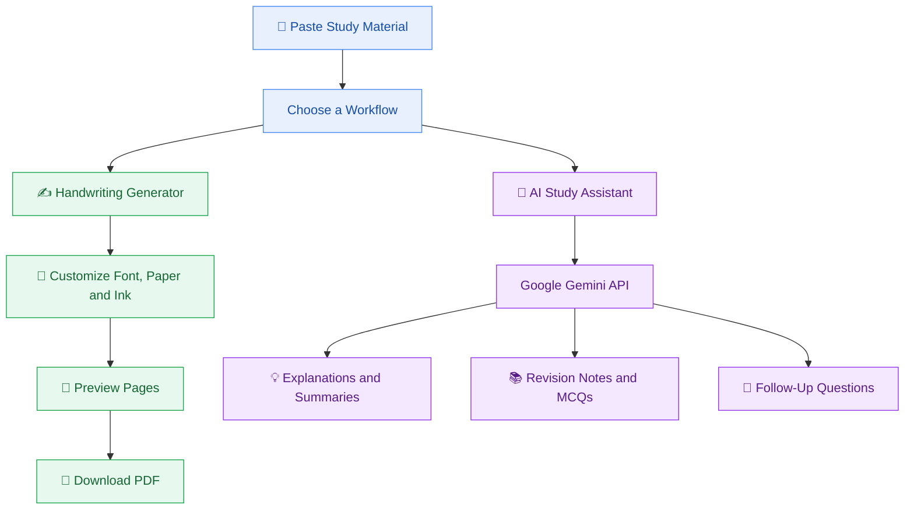

 <div align="center">

# ✍️ Textify AI

### Turn Your Digital Text Into Beautiful Handwriting — Study Smarter With AI

Transform typed text into handwritten-style pages with customizable fonts, paper styles, ink colors, and downloadable PDFs. Use the built-in AI Study Assistant to understand concepts, summarize material, prepare revision notes, and generate practice questions.

[](https://www.python.org/)
[](https://streamlit.io/)
[](https://python-pillow.org/)
[](https://ai.google.dev/)

### [TRY TEXTIFY AI LIVE](https://textifyai.streamlit.app/)

**Paste your text. Customize your handwriting. Learn with AI. Download your PDF.**

[Problem & Solution](#-1-problem-statement) · [Features](#-3-features) · [AI Methodology](#-5-ai-methodology-and-implementation) · [Installation](#-7-setup-and-installation) · [Screenshots](#️-9-product-screenshots)

</div>

---

## 📌 1. Problem Statement

University and college students often work with lengthy digital study materials that can be difficult to understand, summarize, and organize for revision. Preparing useful study notes may require switching between separate tools for AI-assisted explanations, summaries, practice questions, and document formatting.

There is an opportunity to simplify this workflow through an accessible platform that combines AI-powered study assistance with customizable handwritten-style note generation.

## 💡 2. Solution Overview

**Textify AI** is a Python-powered web application that combines handwritten-style document generation with an AI-powered study assistant in one interactive platform.

Students can paste study material and use the Google Gemini-powered assistant to ask questions, understand concepts through simple explanations, generate summaries, prepare revision notes, and create multiple-choice questions.

They can also customize handwriting fonts, paper styles, ink colors, page sizes, orientation, margins, and spacing; preview generated pages; and download their documents as PDFs.

By combining these capabilities in one interface, Textify AI aims to make preparing and organizing study material more convenient.

🌐 **Live Application:** [https://textifyai.streamlit.app/](https://textifyai.streamlit.app/)

💻 **Source Code:** [GitHub Repository](https://github.com/codewithMeesum/Textify-AI-)

---

## ✨ 3. Features

<table>
<tr>
<td width="50%" valign="top">

### ✍️ Handwriting Generator

- 📝 **Text-to-Handwriting:** Transform typed text into handwritten-style pages.
- 🖋️ **Handwriting Fonts:** Choose from available handwriting-style fonts.
- 📄 **Multiple Page Sizes:** Select A4, Letter, or A5.
- 📐 **Page Customization:** Configure supported orientation and margins.
- 📓 **Paper Styles:** Choose from available paper backgrounds and layouts.
- 🎨 **Ink Colors:** Personalize writing with different ink colors.
- 📏 **Spacing Controls:** Adjust line spacing.
- 👀 **Page Preview:** Review generated pages before exporting.
- 📥 **PDF Download:** Save the generated document as a PDF.

</td>
<td width="50%" valign="top">

### 🤖 AI Study Assistant

- 💬 **Content-Based Q&A:** Ask questions about supplied study material.
- 🧠 **Simple Explanations:** Understand difficult concepts in easy language.
- 📝 **Smart Summaries:** Condense lengthy content into concise summaries.
- 📚 **Revision Notes:** Generate organized study notes and outlines.
- ❓ **Practice MCQs:** Generate multiple-choice questions with answer keys.
- 🔄 **Follow-Up Questions:** Continue the conversation to explore a topic.
- 🎯 **Source-Aware Assistance:** Use pasted material as the main reference for study-related questions.

</td>
</tr>
</table>

---

## 🔄 4. How It Works

Textify AI provides two complementary workflows: AI-assisted studying and handwritten-style document generation.



### The two workflows

**AI Study Assistant:** Student input and source material → prompt preparation → Google Gemini API → generated study response.

**Handwriting Generator:** Text input → handwriting and page customization → page preview → PDF export.

The Gemini API powers the study-assistance component. Handwriting rendering and PDF generation are handled by a separate document-generation workflow.

---

## 🛠️ 5. AI Methodology and Implementation

Textify AI integrates the Google Gemini API to provide AI-powered study assistance.

### How the AI assistant works

1. **User input:** The student supplies study material and enters a question or instruction.
2. **Prompt preparation:** The application prepares a prompt containing the user's request, relevant source material, and recent conversation context.
3. **Model inference:** The prompt is sent to the configured Gemini model through the Google Gen AI SDK.
4. **Response generation:** The model generates a response such as an explanation, summary, revision notes, or practice questions.
5. **Display and follow-up:** The application displays the response, allowing the student to continue the conversation.

The prompt instructions prioritize the supplied source material, simple explanations, and avoiding unsupported facts or citations.

### Source material and conversation context

The current implementation passes at most the first **30,000 characters** of the supplied source text to the AI assistant. Recent conversation messages are also included in the prompt to support follow-up questions.

As a result, material beyond the source-text limit may not be considered by the model. Students should provide relevant content and verify important answers.

### Handwriting and PDF generation

The handwriting workflow operates independently of the AI assistant:

1. The user enters or pastes text.
2. The application applies the selected handwriting font and supported page settings.
3. The page-rendering workflow creates the handwritten-style output.
4. The application prepares the document for preview and PDF export.

This separation allows Textify AI to combine AI-assisted studying and document formatting without implying that the AI model itself creates every handwritten page.

---

## 🧠 6. AI Model and API Usage

| Component | Implementation |
|---|---|
| AI provider | Google |
| AI service | Google Gemini API |
| Python SDK | `google-genai` |
| Client initialization | `genai.Client(api_key=api_key)` |
| API method | `client.interactions.create(...)` |
| API credential | `GEMINI_API_KEY` |
| Model identifier | `gemini-3.8-flash` in the previously documented implementation; verify against the final committed `app.py` |

The AI assistant uses the Google Gen AI SDK to send prompts to the configured model and obtain generated responses.

The integration follows this pattern:

```python
from google import genai

client = genai.Client(api_key=api_key)

response = client.interactions.create(
    model="gemini-3.8-flash",
    input=prompt
)
```

**Model verification:** The identifier above reflects the previously documented implementation, not an independently verified inspection of the current GitHub repository. Before submission, confirm that the committed `app.py` contains this exact model identifier and that it is supported by the configured API. If the code differs, update this section to match the actual implementation.

### API key configuration

The AI Study Assistant requires a valid Gemini API key and access to the configured model.

1. Obtain an API key through [Google AI Studio](https://aistudio.google.com/).
2. Create `.streamlit/secrets.toml` in the project directory.
3. Add the following configuration:

```toml
GEMINI_API_KEY = "YOUR_GEMINI_API_KEY"
```

Replace the placeholder with your own key.

For Streamlit Community Cloud, configure `GEMINI_API_KEY` in your app's Secrets settings.

🔐 **Security:** Never commit the real `secrets.toml` file, publish API credentials, or expose secrets in screenshots, logs, or demo videos. Keep the file excluded through `.gitignore` and commit only a safe example configuration.

**Official references:** [Google Gemini API](https://ai.google.dev/gemini-api/docs) · [Google Gen AI Python SDK](https://github.com/googleapis/python-genai)

---

## ⚡ 7. Setup and Installation

Run Textify AI locally using the following steps.

### Prerequisites

- Python installed on your computer.
- Git installed to clone the repository.
- A valid Google Gemini API key.
- Internet access for API requests.

### Step 1: Clone the repository

```bash
git clone https://github.com/codewithMeesum/Textify-AI-.git
cd Textify-AI-
```

### Step 2: Create a virtual environment

**Windows**

```bash
python -m venv venv
venv\Scripts\activate
```

**macOS / Linux**

```bash
python3 -m venv venv
source venv/bin/activate
```

### Step 3: Install dependencies

```bash
pip install -r requirements.txt
```

The project's `requirements.txt` should include the packages required by the actual implementation, including Streamlit, Pillow, Requests, and `google-genai` where used.

### Step 4: Configure the Gemini API key

Create `.streamlit/secrets.toml` and add:

```toml
GEMINI_API_KEY = "YOUR_GEMINI_API_KEY"
```

Keep this file private and excluded from Git.

### Step 5: Launch the application

```bash
streamlit run app.py
```

Open the local URL displayed in the terminal.

> **Note:** These instructions assume the repository contains `app.py`, `requirements.txt`, and the expected Streamlit configuration. The commands and dependency list should match the final committed project.

---

## 📖 8. How to Use

<details>
<summary><strong>✍️ Create handwritten-style notes</strong></summary>

1. Open [Textify AI](https://textifyai.streamlit.app/).
2. Type or paste your text into the input box.
3. Choose an available handwriting font and ink color.
4. Customize the paper style, page size, orientation, margins, and spacing.
5. Generate and preview your handwritten-style pages.
6. Download the resulting PDF.

</details>

<details>
<summary><strong>🤖 Study with the AI Assistant</strong></summary>

1. Open Textify AI and paste your study material into the content box.
2. Find the AI Study Assistant below the content input.
3. Ask a question about your material.
4. Request a simpler explanation, summary, revision notes, or MCQs.
5. Ask follow-up questions to continue exploring the topic.

**Example prompts:**

- Explain this topic in simple words.
- Summarize this content in five bullet points.
- Create 10 MCQs with the correct answers.
- Turn this material into revision notes.
- Explain the difference between these two concepts.
- Rewrite the previous explanation in three lines.

</details>

---

## 🖼️ 9. Product Screenshots

The following four screenshots are provided through Google Drive. They should be accessible to reviewers with the appropriate sharing permissions.

### Screenshot 1

[](https://drive.google.com/file/d/1ql8a0icj0GXd2X8IaVvBrVg4hWzt6xMk/view?usp=sharing)

[Open Screenshot 1](https://drive.google.com/file/d/1ql8a0icj0GXd2X8IaVvBrVg4hWzt6xMk/view?usp=sharing)

### Screenshot 2

[](https://drive.google.com/file/d/1_vl7wrX4Qw_Z3ukact8d0vBHGffVYDxl/view?usp=sharing)

[Open Screenshot 2](https://drive.google.com/file/d/1_vl7wrX4Qw_Z3ukact8d0vBHGffVYDxl/view?usp=sharing)

### Screenshot 3

[](https://drive.google.com/file/d/1b7DkmPzGz4qQroZPFm54hG78qm-60_5v/view?usp=sharing)

[Open Screenshot 3](https://drive.google.com/file/d/1b7DkmPzGz4qQroZPFm54hG78qm-60_5v/view?usp=sharing)

### Screenshot 4

[](https://drive.google.com/file/d/16mAMcacOVwKNNlZYr157SQI8JidsPRc1/view?usp=sharing)

[Open Screenshot 4](https://drive.google.com/file/d/16mAMcacOVwKNNlZYr157SQI8JidsPRc1/view?usp=sharing)

**Screenshot note:** The image previews use Google Drive's direct-view URL format. Their rendering has not been verified in GitHub. If they do not display, download the images and commit them under `assets/screenshots/`, then replace these remote image URLs with repository-relative paths. GitHub supports relative image paths for files stored in a repository.

---

## ⚠️ 10. AI Limitations and Responsible Use

- AI-generated responses may contain errors or incomplete information.
- Students should verify important facts and review generated study material.
- The current implementation sends at most the first 30,000 characters of supplied source text to the AI assistant.
- AI functionality depends on API availability, model access, network connectivity, and applicable usage limits.
- Generated summaries and practice questions should be reviewed before academic use.
- Handwritten-style output is a visual rendering of text, not a scan of genuine handwritten notes.
- Users should avoid submitting sensitive or confidential information.
- API credentials must be stored securely and excluded from the public repository.

Textify AI is intended to support studying and revision, not replace independent thinking, textbooks, instructors, or academic verification.

---

## 📂 11. Project Structure

The project is expected to follow a structure similar to this:

```text
Textify-AI-/
├── .streamlit/
│   └── secrets.toml.example
├── assets/
│   ├── fonts/
│   └── screenshots/
├── app.py
├── requirements.txt
├── README.md
└── .gitignore
```

The final repository may contain additional files depending on the implementation.

**Security note:** Keep the real `.streamlit/secrets.toml` file private. Commit only an example configuration with placeholder values.

---

## 👨‍💻 12. Team Member Contributions

### Solo Project — Mesumm Mukhtar

Textify AI is a solo project, with project development and submission managed by one contributor.

The project's contribution areas include:

- **Application development:** Python and Streamlit application implementation.
- **AI integration:** Google Gemini API integration and the study-assistant prompt workflow.
- **Handwriting generation:** Text rendering, page customization, preview, and PDF-export workflow.
- **Testing and deployment:** Application testing, issue resolution, and deployment configuration.
- **Documentation and presentation:** Project documentation and hackathon demonstration.

These contribution areas should accurately reflect the work completed. AI-assisted development tools should be disclosed where required by the hackathon rules. The AI service integrated into the product itself is the Google Gemini API.

---

## 🎯 13. Future Improvements

Potential future improvements include:

- Support for larger study documents and additional file formats.
- More handwriting styles and page customization options.
- Additional revision and study workflows.
- Further testing of usability, accessibility, and AI response quality.

These are proposed improvements, not claims about currently implemented functionality.

---

## 🏆 14. NYLP AI Hackathon 2026

**Project Name:** Textify AI  
**Developer:** Mesumm Mukhtar  
**Theme:** Build AI for Real-World Impact

Textify AI combines AI-assisted study support with customizable handwritten-style note generation to address a practical challenge faced by students working with digital study material.

- **Live Demo:** [https://textifyai.streamlit.app/](https://textifyai.streamlit.app/)
- **GitHub Repository:** [https://github.com/codewithMeesum/Textify-AI-](https://github.com/codewithMeesum/Textify-AI-)

This README documents the problem, solution, technology stack, setup process, AI methodology, model/API integration, product screenshots, limitations, and solo-project contributions for hackathon review.

---

<div align="center">

### Built with Python, Streamlit, and Google Gemini

**Textify AI — Digital Text, Handwritten Style. Smarter Study.**

⭐ If you find this project useful, consider giving the repository a star!

</div>
