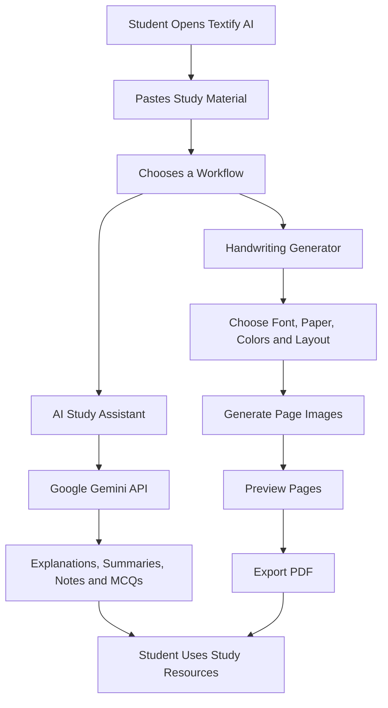

# Textify AI

<p align="center">
  <strong>Turn Digital Text into Beautiful Handwriting — Study Smarter with AI</strong>
</p>

<p align="center">
  Textify AI combines AI-powered study assistance with customizable handwritten-style notes in one accessible web application.
</p>

<p align="center">
  <a href="https://textifyai.streamlit.app/"><strong> Try the Live Demo</strong></a>
  &nbsp; | &nbsp;
  <a href="https://github.com/codewithMeesum/Textify-AI-"><strong>💻 View Source Code</strong></a>
</p>

<p align="center">
  
  
  
  
</p>

---

## 1. Problem Statement

University and college students often work with lengthy digital study materials that can be difficult to understand, summarize, and organize for revision. Preparing useful study notes may involve switching between separate tools for AI-assisted explanations, summaries, practice questions, and document formatting.

There is an opportunity to simplify this workflow through an accessible platform that combines AI-powered study assistance with customizable handwritten-style note generation.

## 2. Proposed Solution

**Textify AI** is an AI-powered study and note-preparation web application designed for university and college students. It combines a Google Gemini-powered AI Study Assistant with a customizable handwriting generator in one platform.

Students can paste their study material and use the AI assistant to ask questions, understand concepts through simple explanations, generate summaries, prepare revision notes, and create multiple-choice questions. They can then use the handwriting generator to customize fonts, paper styles, ink colors, and page layouts, preview their pages, and download their documents as PDFs.

By bringing AI-assisted study support and handwritten-style document creation together, Textify AI aims to make preparing and organizing study material more convenient through a single, accessible interface.

## 3. Key Features

| Feature | Description |
|---|---|
| **AI Study Assistant** | Ask questions about study material and receive contextual explanations. |
| **Simple Explanations** | Request explanations of difficult concepts in beginner-friendly language. |
| **Study Summaries** | Generate concise summaries of the supplied material. |
| **Revision Notes** | Create structured revision notes and outlines. |
| **MCQ Generation** | Generate multiple-choice practice questions from study content. |
| **Handwriting Styles** | Choose from Caveat, Patrick Hand, and Kalam font styles. |
| **Paper Customization** | Choose ruled, plain, grid, dotted, or margin-line paper. |
| **Paper and Ink Colors** | Customize paper backgrounds and ink colors. |
| **Page Layout** | Select A4, Letter, or A5 paper and portrait or landscape orientation. |
| **Spacing Controls** | Adjust margins, line spacing, letter spacing, and word spacing. |
| **Handwritten Variation** | Apply slight horizontal variation for a more natural-looking layout. |
| **Multi-Page Preview** | Preview generated handwritten-style pages before exporting. |
| **PDF Export** | Download generated notes as PDF documents. |
| **Conversational Follow-Ups** | Continue asking questions using recent conversation context. |
| **Browser-Based Access** | Use the application through a web browser without installing a desktop application. |

## 4. How Textify AI Works

The application combines two connected workflows: AI-assisted study support and handwritten-style document generation.



### Workflow overview

1. The student opens Textify AI and supplies their study material.
2. They can ask the AI assistant questions about the material or request study resources.
3. The AI workflow sends a prepared prompt to the configured Google Gemini model.
4. Alternatively, the student can customize the handwriting generator's appearance and page settings.
5. The application renders the text into page images and provides a multi-page preview.
6. The student can export the generated pages as a PDF.

The AI assistant and handwriting generator serve complementary purposes: one helps students work with study content, while the other formats text into handwritten-style documents.

## 5. Technology Stack

| Technology | Purpose |
|---|---|
| **Python** | Core application programming language. |
| **Streamlit** | Web interface, interactive controls, and application workflow. |
| **Google Gemini API** | AI-powered study assistance. |
| **Google Gen AI Python SDK (`google-genai`)** | Communication with the configured Gemini model. |
| **Pillow (`PIL`)** | Text rendering, page image creation, and image processing. |
| **Requests** | HTTP requests, including font downloads used by the application. |
| **PDF utilities in Pillow** | Export rendered pages into PDF documents. |
| **Streamlit Community Cloud** | Hosting the live application. |
| **Git and GitHub** | Source control and project hosting. |

## 6. AI Methodology and Implementation

AI is a functional part of Textify AI's study assistant, rather than merely a tool used during development.

### AI model

| Item | Implementation |
|---|---|
| AI provider | Google |
| Model identifier in source code | `gemini-3.8-flash` |
| Python SDK | `google-genai` |
| API client | `genai.Client(api_key=api_key)` |
| API method | `client.interactions.create()` |
| API credential | `GEMINI_API_KEY`, configured through Streamlit Secrets |

The model identifier above is taken from the application's source code. Successful API access depends on the model being available to the configured API account and the account's access, quota, and billing settings.

### How the AI assistant works

**1. User input**

The student supplies source material and asks a question or requests an output, such as an explanation, summary, revision outline, or MCQs.

**2. Context preparation**

The application prepares a prompt containing relevant source text, the user's request, and recent conversation messages where applicable. The source text passed to the AI is limited to the first 30,000 characters.

**3. Prompt-based guidance**

The prompt instructs the assistant to:

- Prioritize the student's supplied material.
- Explain concepts clearly and simply.
- Create summaries, notes, outlines, and practice questions when requested.
- Maintain conversational context for follow-up questions.
- Avoid inventing facts or citations.
- Acknowledge uncertainty when the available information is insufficient.

**4. Model request**

The application uses the Google Gen AI Python SDK to send the prepared input to the configured Gemini model through `client.interactions.create()`.

**5. Response presentation**

The returned response is displayed in the Streamlit interface so the student can continue the conversation or use the generated study content.

### API key configuration

The API key is read from Streamlit Secrets using the `GEMINI_API_KEY` setting.

For local development, create a file named `.streamlit/secrets.toml`:

```toml
GEMINI_API_KEY = "YOUR_GEMINI_API_KEY"
```

Replace the placeholder with your own key. Never commit a real API key to GitHub or include it in screenshots, public logs, or demonstration videos.

For deployment, configure the same secret in the application's Streamlit Community Cloud settings.

## 7. Setup and Installation

### Prerequisites

- Python installed on your computer.
- Git installed if you plan to clone the repository.
- A Google Gemini API key for the AI Study Assistant.
- Internet access for installing dependencies and accessing the AI API.

### Step 1: Clone the repository

```bash
git clone https://github.com/codewithMeesum/Textify-AI-.git
cd Textify-AI-
```

### Step 2: Create a virtual environment (recommended)

```bash
python -m venv .venv
```

Activate it on Windows:

```bash
.venv\Scripts\activate
```

On macOS or Linux:

```bash
source .venv/bin/activate
```

### Step 3: Install dependencies

```bash
python -m pip install -r requirements.txt
```

The dependency file should include the packages required by the application:

```text
streamlit
Pillow
requests
google-genai
```

Use the repository's actual `requirements.txt` as the source of truth if its package versions or dependencies differ.

### Step 4: Configure the API key

Create `.streamlit/secrets.toml` and add your Gemini API key:

```toml
GEMINI_API_KEY = "YOUR_GEMINI_API_KEY"
```

Keep this file private. If it is not already excluded, add `.streamlit/secrets.toml` to `.gitignore`.

### Step 5: Run the application

```bash
streamlit run app.py
```

Streamlit will display a local URL in the terminal. Open that URL in your browser.

**Note:** The handwriting generator and the AI Study Assistant have different requirements. AI features need a valid API configuration, while PDF generation relies on the application's rendering and export dependencies.

## 8. How to Use Textify AI

### A. Generate handwritten-style notes

1. Open the application.
2. Paste or enter the text you want to format.
3. Choose a handwriting font.
4. Select a paper style, paper color, and ink color.
5. Choose a page size and orientation.
6. Adjust spacing and margins to suit your content.
7. Review the generated pages in the preview.
8. Export the document as a PDF.

### B. Use the AI Study Assistant

1. Enter or paste the relevant study material.
2. Ask a question about the supplied content.
3. Request a simple explanation, summary, revision notes, an outline, or MCQs.
4. Review the response and verify important facts against your course materials.
5. Ask follow-up questions to explore a concept further.

### C. Example prompts

These are examples of requests you can type into the AI Study Assistant:

- "Explain this topic in simple language."
- "Summarize the main ideas from this material."
- "Create structured revision notes."
- "Generate multiple-choice questions with answers."
- "Explain the difference between these two concepts using examples."

The examples above are suggested user inputs, not claims that the interface contains preset prompt buttons.

## 9. Product Screenshots

The following links point to screenshots supplied for the project. They are provided as linked images; if GitHub does not render them, check the Google Drive sharing permissions or save the actual image files inside the repository.

### Screenshot 1

[Open Screenshot 1](https://drive.google.com/file/d/1ql8a0icj0GXd2X8IaVvBrVg4hWzt6xMk/view?usp=sharing)


### Screenshot 2

[Open Screenshot 2](https://drive.google.com/file/d/1_vl7wrX4Qw_Z3ukact8d0vBHGffVYDxl/view?usp=sharing)


### Screenshot 3

[Open Screenshot 3](https://drive.google.com/file/d/1b7DkmPzGz4qQroZPFm54hG78qm-60_5v/view?usp=sharing)


### Screenshot 4

[Open Screenshot 4](https://drive.google.com/file/d/16mAMcacOVwKNNlZYr157SQI8JidsPRc1/view?usp=sharing)


**Recommended for reliable GitHub rendering:** Download the four images, add them to `assets/screenshots/`, and update the image paths to:

```markdown


```

Use the actual file extensions of your downloaded images. Ensure the Drive links are accessible to reviewers and that screenshots show genuine application output.

## 10. AI Limitations and Responsible Use

Textify AI is intended to support studying and document preparation. It does not replace textbooks, instructors, or independent verification.

- **AI accuracy:** Gemini can produce incomplete, inaccurate, or misleading responses. Check important information against reliable course materials.
- **Source context limit:** The current implementation sends at most the first 30,000 characters of source text to the AI. Material beyond that limit may not be considered.
- **API availability:** AI responses depend on valid credentials, model access, network connectivity, and applicable usage limits.
- **Privacy:** Avoid pasting passwords, private records, or sensitive personal information into the application.
- **Handwriting appearance:** Generated documents imitate handwriting visually; they are not actual handwriting and may not perfectly reproduce natural pen strokes.
- **Font availability:** Downloaded fonts may require internet access or a valid source. Network or font-loading issues can affect rendering.
- **PDF review:** Check page breaks, text placement, special characters, and formatting before relying on an exported document.
- **Academic integrity:** Use generated explanations and practice questions to support understanding. Follow your institution's rules when preparing and submitting academic work.

Textify AI does not claim guaranteed grades, guaranteed learning outcomes, or error-free AI responses.

## 11. Project Structure

The repository can be organized as follows:

```text
Textify-AI-/
├── .streamlit/
│   └── secrets.toml.example
├── assets/
│   ├── fonts/
│   └── screenshots/
├── app.py
├── requirements.txt
├── README.md
└── .gitignore
```

The exact contents of the repository may differ. Keep actual application files, dependencies, assets, and documentation consistent with the structure committed to GitHub.

**Security reminder:** Commit only a safe example configuration such as `secrets.toml.example`. Do not commit `.streamlit/secrets.toml` containing a real API key.

## 12. Team Members and Contributions

**Project type:** Solo project

**Developer:** Mesum Mukhtar

As the sole project contributor, I am responsible for the project's development and presentation, including:

- Designing and implementing the Streamlit application.
- Developing the handwriting-style rendering and PDF export workflow.
- Integrating the Google Gemini API for AI-assisted study features.
- Preparing the application's interface and configuration.
- Testing application components and refining the workflow.
- Preparing the documentation, screenshots, and hackathon demonstration.

No additional team members are claimed for this submission.

## 13. Future Improvements

Potential improvements include:

- Support for uploading PDF and other study documents directly.
- Additional handwriting styles and paper templates.
- More advanced page-layout and formatting controls.
- Improved handling of longer source documents.
- More extensive automated tests for AI responses and PDF rendering.
- Better font caching and resilience to network failures.
- More options for exporting and organizing study resources.
- Additional accessibility and language support.

These are possible future enhancements and are not presented as completed features.

## 14. Project Links

| Resource | Link |
|---|---|
| **Live Application** | [textifyai.streamlit.app](https://textifyai.streamlit.app/) |
| **GitHub Repository** | [Textify AI source code](https://github.com/codewithMeesum/Textify-AI-) |
| **AI Provider** | [Google AI for Developers](https://ai.google.dev/) |
| **Web Framework** | [Streamlit documentation](https://docs.streamlit.io/) |

## 15. NYLP AI Hackathon 2026

Textify AI is submitted in the context of the **NYLP AI Hackathon 2026** and the theme **"Build AI for Real-World Impact."**

The project applies generative AI to an educational workflow by combining source-based study assistance with a handwriting-style document generator.

The submission aims to demonstrate:

- A practical student-focused problem and a working product.
- Meaningful use of an external AI model and API.
- A clear implementation and technology stack.
- An accessible live demonstration and source repository.
- Transparent limitations and responsible AI use.

---

<p align="center">
  <strong>Textify AI — Study, Understand, Organize.</strong>
</p>

<p align="center">
  Built by Mesum Mukhtar
</p>
