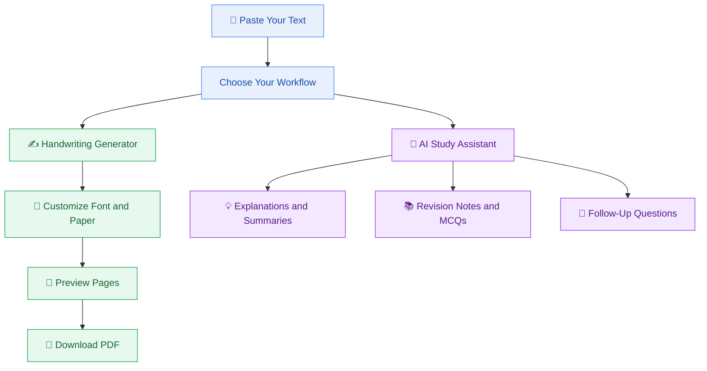

# ✍️ Textify AI

<div align="center">

### Turn Your Digital Text Into Beautiful Handwriting — Study Smarter With AI

Transform typed text into handwriting-style pages with customizable fonts, paper styles, ink colors, and downloadable PDFs. Use the built-in AI Study Assistant to understand concepts, summarize material, create revision notes, and generate practice questions.

<br>

[](https://www.python.org/)
[](https://streamlit.io/)
[](https://python-pillow.org/)
[](https://ai.google.dev/)

<br>

### [ TRY TEXTIFY AI LIVE](https://textifyai.streamlit.app/)

**Paste your text. Customize your handwriting. Learn with AI. Download your PDF.**

</div>

---

## 📌 About Textify AI

Textify AI is a Python-powered web application that combines **handwriting-style document generation** with an **AI-powered study assistant** in one interactive platform.

Customize fonts, paper layouts, ink colors, page sizes, and spacing to create handwritten-style documents. You can also chat with the built-in Google Gemini-powered assistant to understand your study material, simplify complex topics, prepare revision notes, and generate practice questions.

🌐 **Live Application:** [textifyai.streamlit.app](https://textifyai.streamlit.app/)

---

## ✨ Features

<table>
<tr>
<td width="50%" valign="top">

### ✍️ Handwriting Generator

- 📝 **Text-to-Handwriting:** Transform typed text into handwritten-style pages.
- 🖋️ **Handwriting Fonts:** Choose from available handwriting-style fonts.
- 📄 **Multiple Page Sizes:** Select A4, Letter, or A5.
- 📐 **Page Customization:** Configure orientation and margins.
- 📓 **Paper Styles:** Choose from available paper backgrounds and layouts.
- 🎨 **Ink Colors:** Personalize your writing with different ink colors.
- 📏 **Spacing Controls:** Adjust line spacing.
- 👀 **Page Preview:** Review generated pages before exporting.
- 📥 **PDF Download:** Save your document as a PDF.

</td>
<td width="50%" valign="top">

### 🤖 AI Study Assistant

- 💬 **Content-Based Q&A:** Ask questions about your pasted study material.
- 🧠 **Simple Explanations:** Understand difficult concepts in easy language.
- 📝 **Smart Summaries:** Condense lengthy content into concise summaries.
- 📚 **Revision Notes:** Generate organized study notes and outlines.
- ❓ **Practice MCQs:** Create multiple-choice questions with answer keys.
- 🔄 **Follow-Up Questions:** Continue the conversation to explore a topic.
- 🎯 **Context-Aware Help:** Use the pasted material as the main reference for study-related questions.

</td>
</tr>
</table>

---

## 🔄 How It Works



---

## 🛠️ Tech Stack

| Technology | Purpose |
|---|---|
| Python | Core application logic |
| Streamlit | Interactive web interface |
| Pillow (PIL) | Image generation and text rendering |
| Requests | Downloading handwriting fonts when required |
| Google Gemini API | AI-powered study assistance |
| Google Gen AI SDK (`google-genai`) | Connecting the application to Gemini |

---

## ⚡ Getting Started

Run Textify AI locally using the following steps.

### 1. Clone the repository

```bash
git clone https://github.com/codewithMeesum/Textify-AI-.git
cd Textify-AI-
```

### 2. Create a virtual environment

**Windows**

```bash
python -m venv venv
venv\Scripts\activate
```

**macOS / Linux**

```bash
python3 -m venv venv
source venv/bin/activate
```

### 3. Install dependencies

```bash
pip install -r requirements.txt
```

### 4. Configure the Gemini API key

The AI Study Assistant requires a valid Gemini API key.

1. Get an API key from [Google AI Studio](https://aistudio.google.com/).
2. Create a `.streamlit/secrets.toml` file in your project directory if it does not already exist.
3. Add the following configuration:

```toml
GEMINI_API_KEY = "your-gemini-api-key"
```

Replace the placeholder with your own key.

### 5. Launch the application

```bash
streamlit run app.py
```

Open the local URL displayed in your terminal.

> 🔐 **Security:** Never publish your real API key or commit a secrets file containing it to GitHub. Keep `.streamlit/secrets.toml` excluded through `.gitignore`. On Streamlit Community Cloud, configure `GEMINI_API_KEY` in your app's Secrets settings.

---

## 📖 How to Use

<details>
<summary><strong>✍️ Create handwritten-style notes</strong></summary>

1. Open [Textify AI](https://textifyai.streamlit.app/).
2. Type or paste your text into the input box.
3. Choose your handwriting font and ink color.
4. Customize the paper style, page size, orientation, margins, and spacing.
5. Generate and preview your handwritten pages.
6. Download the generated PDF.

</details>

<details>
<summary><strong>🤖 Study with the AI Assistant</strong></summary>

1. Open Textify AI and paste your study material into the content box.
2. Find the AI Study Assistant below the content input.
3. Ask a question about your material.
4. Request a simpler explanation, summary, revision notes, or MCQs.
5. Ask follow-up questions to continue learning.

**Example prompts:**

- Explain this topic in simple words.
- Summarize this content in five bullet points.
- Create 10 MCQs with the correct answers.
- Turn this material into revision notes.
- Explain the difference between these two concepts.
- Rewrite the previous explanation in three lines.

</details>

---

## ⚠️ AI Limitations

- AI-generated responses may contain errors, so verify important information.
- Answers depend on the supplied content and the question asked.
- Very long source text may be truncated before it reaches the AI model.
- AI features require a valid API key, available model access, and sufficient API quota.

---

## 📂 Project Structure

```text
Textify-AI-/
├── .streamlit/
│   └── secrets.toml.example
├── assets/
│   └── fonts/
├── app.py
├── requirements.txt
├── README.md
└── .gitignore
```

The actual project structure may contain additional files depending on your local setup.

**Security note:** Keep the real `.streamlit/secrets.toml` file private. Commit only the example configuration with placeholder values.

---

## 🌐 Try It Online

<div align="center">

### Ready to transform your text and study smarter?

Create handwritten-style documents and explore AI-powered learning assistance in one place.

<br>

### 👉 [OPEN TEXTIFY AI](https://textifyai.streamlit.app/)

</div>

---

## 🎯 Project Vision

Textify AI aims to make handwriting-style document creation and AI-assisted studying more accessible through a simple, interactive web application.

By bringing customizable handwriting generation and conversational study assistance together, the project helps students prepare notes and engage with their learning material in one place.

---

## 👨‍💻 Developer

**Mesumm Mukhtar**

Computer Science Student | University of Baltistan, Skardu

- GitHub: [@codewithMeesum](https://github.com/codewithMeesum)
- Live Project: [Textify AI](https://textifyai.streamlit.app/)

---

<div align="center">

### Built with Python, Streamlit, and Google Gemini

**Textify AI — Digital Text, Handwritten Style. Smarter Study.**

⭐ If you find this project useful, consider giving the repository a star!

</div>
